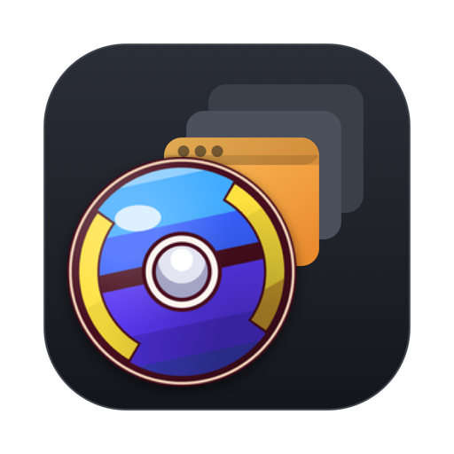

<div align="center">



# PokeIdle Deck

**Até 4 contas do [PokeIdle](https://pokeidle.io) numa janela só, com recompra e lives no automático.**

[](https://github.com/darlanhms/pokeidleDeck/releases/latest)


[](LICENSE)

[macOS](#instalar-no-macos) · [Windows](#instalar-no-windows) · [O que faz](#o-que-ele-faz) · [Primeiros passos](#primeiros-passos)

</div>

---

Um app para macOS e Windows que joga o [PokeIdle](https://pokeidle.io) em até 4 contas ao mesmo tempo, numa janela só, e
cuida sozinho do que é repetitivo: comprar itens, e assistir às lives da Twitch e da Kick para ganhar o bônus do
jogo.

Nasceu como a versão para Mac do [PokeIdleMulti](https://github.com/artbruno35/PokeIdleMulti), que é só para Windows.

## O que ele faz

### Contas

- De 1 a 4 contas na mesma janela. Cada uma tem o próprio login e os próprios dados, sem misturar com as outras.
- O layout se ajusta ao número de contas: lado a lado, empilhadas ou em grade. Dá para ampliar uma conta e
  alternar entre elas por abas.
- Adicionar, renomear, reordenar (arrastando o cabeçalho de uma conta sobre o de outra), silenciar e desligar
  contas. Uma conta removida pode ser restaurada.
- No cabeçalho de cada conta: o ouro, o tempo jogando, o estado da recompra e o das lives.

### Automações

- **Recompra:** compra pokébolas, poções e revives no Market quando o estoque fica abaixo do mínimo que você
  escolher, sem gastar abaixo de um piso de ouro. Pode pôr a poção escolhida em 1º na fila do "Usar Poções".
- **Eco:** o que você faz numa conta se repete nas outras.
- **ULTRA** e **menos animações:** deixam o jogo mais leve com várias contas abertas.

### Lives da Twitch e da Kick

O jogo dá bônus de XP, captura e shiny em troca dos pontos dos canais dos streamers oficiais. O deck:

- Pega a lista de streamers oficiais do próprio jogo e sabe quem está no ar.
- Deixa as lives tocando escondidas e mudas em cada conta, 2 por site, que é onde os pontos sobem.
- Escolhe as lives sozinho, ou toca a que você fixar numa vaga. Se ela sair do ar, outra cobre até ela voltar.
- Mostra numa **Central das lives** o saldo de pontos em todos os canais e quais já dão para resgatar.
- Resgata em um clique o bônus que você escolher, no pacote que quiser (1h, 3h, 5h ou 10h), ou resgata
  sozinho. Também pega o baú de pontos da Twitch.
- Bloqueia os anúncios das lives.

## Instalar no macOS

Precisa do macOS 14 (Sonoma) ou mais novo. Funciona em Mac com Apple Silicon e com Intel.

1. Baixe o arquivo `PokeIdle Deck_<versão>_universal.dmg` do último lançamento, na página de
   [Releases](https://github.com/darlanhms/pokeidleDeck/releases).
2. Abra o `.dmg` e arraste o **PokeIdle Deck** para a pasta **Aplicativos**.
3. Abra o **PokeIdle Deck** pela pasta Aplicativos. Na primeira vez o macOS bloqueia; siga o passo abaixo.

### Liberar na primeira vez ("Abrir Mesmo Assim")

O app não é assinado pela Apple (isso exige uma conta paga de desenvolvedor), então o macOS avisa que não
consegue verificar quem fez o app e não abre. Para liberar:

1. Abra o app uma vez e feche o aviso.
2. Abra **Ajustes do Sistema → Privacidade e Segurança**.
3. Role até a mensagem sobre o **PokeIdle Deck** e clique em **Abrir Mesmo Assim**.
4. Confirme com a senha do Mac ou o Touch ID.

Das próximas vezes ele abre direto.

Se em vez disso o macOS disser que o app **está danificado**, rode no Terminal e abra de novo:

```
xattr -cr "/Applications/PokeIdle Deck.app"
```

## Instalar no Windows

Precisa do Windows 10 ou 11 (64 bits).

1. Baixe o arquivo `PokeIdle Deck_<versão>_x64-setup.exe` do último lançamento, na página de
   [Releases](https://github.com/darlanhms/pokeidleDeck/releases).
2. Abra o instalador. Ele instala só para o seu usuário, sem pedir senha de administrador.
3. Se o Windows não tiver o WebView2 (o motor do Edge), o instalador baixa sozinho.

### Liberar na primeira vez ("Executar assim mesmo")

O instalador não é assinado, então o Windows SmartScreen pode avisar que "o Windows protegeu o computador":

1. Clique em **Mais informações**.
2. Clique em **Executar assim mesmo**.

### Primeiros passos

1. Na primeira conta, entre no PokeIdle normalmente.
2. Para mais contas, clique em **Nova conta** na barra de cima.
3. Para as lives, abra a pílula **Lives** na barra de cima e entre na Twitch e na Kick em cada conta, pela
   própria central. Vincule também a Twitch e a Kick dentro do jogo, senão os pontos não viram bônus.

## Para desenvolvedores

```
npm install
npm run tauri dev
```

Testes: `npm test` e `cargo test` em `src-tauri`. Os autotestes que abrem o app estão em `SPIKE.md`.

Para lançar uma versão, suba uma tag `v*`. O GitHub Actions (`.github/workflows/release.yml`) roda os testes,
gera o `.dmg` universal e publica no Release:

```
git tag v0.2.0
git push origin v0.2.0
```
